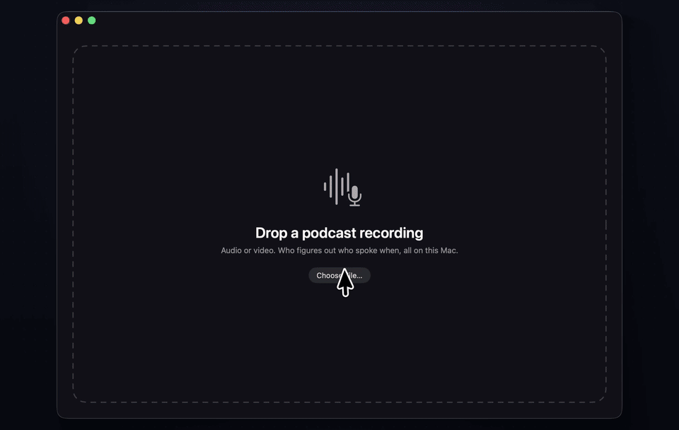

# Who Said What

A small macOS app that turns a podcast, interview or meeting recording into a transcript where every line is assigned to a speaker. Drop an audio or video file on the window and you get a speaker timeline, a clickable transcript and exports for subtitles and show notes. Everything runs on your Mac. No audio is uploaded.



It's built on two on-device models from [Desert Ant Labs](https://desertant.com/): [**Who**](https://desertant.com/models/who/) for speaker diarization and [**Voz**](https://github.com/Desert-Ant-Labs/desert-ant-core/blob/main/docs/models/voz.md) for speech recognition. Apple's built-in speech transcriber is still available as an option.

## How it works

Who works out *who spoke when*: it returns numbered speaker turns with start and end times. It doesn't transcribe and doesn't know anyone's name. To get "who said what", the app runs two on-device models at the same time:

| Step | Model | Output |
| --- | --- | --- |
| Who spoke when | **Who** (Swift SDK [`desert-ant-core`](https://github.com/Desert-Ant-Labs/desert-ant-core) 4.1, `Who` product) | Speaker turns: `speaker`, `start`, `end` |
| What was said | **Voz** (same SDK, `Voz` product), or **Apple `SpeechTranscriber`** (Speech framework, macOS 26) | Words with timestamps |

Each word goes to the speaker turn it overlaps most; a word in a gap goes to the nearest turn. Consecutive words from the same speaker become one paragraph.

## Features

- **Drop zone** or a "Choose File…" button. Takes WAV, MP3, M4A, AIFF, MP4 and MOV.
- **Live progress** with a running timer and two progress bars (Who labelling speakers, and transcription), each with a live "× realtime" figure.
- **Speed tiles** on the results screen for Who, speech to text and the whole pipeline.
- **Speaker timeline**: one coloured lane per speaker. Click anywhere to jump there.
- **Transcript**: click a line to play from that point. The line being played is highlighted and scrolls into view.
- **Video panel** for video files: the border takes the current speaker's colour and their name shows in the corner.
- **Rename speakers**: click a speaker chip or a name in the transcript, type a name and press Return. Names show up everywhere, including exports.
- **Export** (⌘E) with your speaker names:

  | Format | Looks like | Good for |
  | --- | --- | --- |
  | Text with timecodes (`.txt`) | `[00:01:23] Name: what they said` | Show notes, reading, docs |
  | Subtitles (`.srt`) | `Name: what they said`, short cues | YouTube, Premiere, Final Cut, DaVinci |
  | Web subtitles (`.vtt`) | `<v Name>what they said` | HTML5 video players |
  | JSON (`.json`) | speakers, plus segments with `start`/`end` in seconds | Other tools and scripts |

- **Space bar** plays and pauses. **Copy transcript** is in the ⋯ menu.

## Choosing the transcriber

Voz is the default. It was more accurate than Apple's `SpeechTranscriber` on every test set we tried, and faster: 6.3% vs 7.9% word error rate on short clips from the Open ASR leaderboard test sets, and 5.0% vs 6.5% on full TED talks and earnings calls, at 549x vs 78x realtime on long recordings (M5 Max). [docs/benchmark.md](docs/benchmark.md) has the method and the per-dataset numbers, and `benchmark/` re-runs it.

Use Apple's transcriber instead, which needs no model download:

```sh
defaults write com.andrisgauracs.whosaidwhat transcriber apple     # app, from now on
defaults delete com.andrisgauracs.whosaidwhat transcriber          # back to Voz
WhoSaidWhat.app/Contents/MacOS/WhoSaidWhat --print episode.wav --transcriber apple
```

## Requirements

- macOS 26 on Apple Silicon
- Xcode 26 or newer (Swift 6.2+)

## Build and run

```sh
./build_app.sh                      # builds WhoSaidWhat.app (ad-hoc signed)
open WhoSaidWhat.app                # then drag a file on the window

# open straight into a file
open WhoSaidWhat.app --args -open /path/to/episode.mp4

# headless: write a transcript file (speed numbers go to stderr)
WhoSaidWhat.app/Contents/MacOS/WhoSaidWhat --print episode.wav > episode.txt
WhoSaidWhat.app/Contents/MacOS/WhoSaidWhat --print episode.mp4 --format srt --names "Host,Guest" > episode.srt
#   --format  txt (default) | srt | vtt | json
#   --names   comma-separated, in order of first appearance
#   --transcriber  voz (default) | apple
```

The first run downloads Who's model (~81 MB) and Voz's (~337 MB), both Core ML, then Core ML prepares them for the Neural Engine. That one-time step takes about 10 seconds for Voz and 2-3 minutes for Who on an M5 Max. The app starts loading Voz at launch and lets it finish before Who starts, so transcription isn't stuck behind Who's preparation. After the first run, both load in under a second and everything works offline. With `--transcriber apple`, Apple's English speech model downloads instead of Voz.

## Project layout

```
Package.swift                       SwiftPM package: macOS 26, depends on desert-ant-core 4.1 (Who, Voz)
build_app.sh                        Builds release and bundles WhoSaidWhat.app
Sources/WhoSaidWhat/
  App.swift                         App entry point, plus the headless --print mode
  Pipeline.swift                    Audio prep, Who diarization, Voz or SpeechTranscriber transcription, word/speaker alignment
  Export.swift                      Transcript rendering: TXT, SRT, VTT, JSON
  ContentView.swift                 UI: drop zone, progress, results, timeline, video panel, rename, export
benchmark/                          Voz vs SpeechTranscriber benchmark: harness, data prep, scoring (docs/benchmark.md)
```

## Implementation notes

- **Audio prep**: video files have their audio track decoded losslessly to a temporary PCM file with `AVAssetReader`, so there's no extra lossy step.
- **Who input**: the app decodes audio to 16 kHz mono itself and calls `who.diarize(samples:sampleRate:)`, so the timing covers only the model.
- **Voz input**: the same, decoded at `voz.sampleRate` and passed to `voz.transcribe(samples:)`. Voz words carry no spacing, so the app adds a leading space to match SpeechTranscriber's runs, which the exports join as they are.
- **Model checks**: `Voz.isDownloaded()` hashes every weight file (337 MB), so the app calls it once, off the main thread, when transcription starts. It's never called from the UI.
- **Phantom speakers**: laughs or coughs can get their own label. `keepingSpeakers(minimumShare: 0.02)` drops speakers under 2% of the recording, and the UI hides any speaker left with no transcribed words.
- **Timing**: Who's number excludes the model download and audio decoding; the transcription number excludes the model download and load (Voz) or the one-time install of Apple's speech model. Both models run concurrently, so the pipeline takes about as long as the slower one.

## Limitations

- Who labels up to 4 speakers per five-minute section and works best on close-miked audio (podcasts, interviews, remote calls).
- Voz supports 25 languages but doesn't detect which one it's hearing. Audio in an unsupported language comes back as fluent, wrong text. The Apple transcriber is set to US English.
- Voz writes numbers as words ("seven hundred million dollars", "COVID nineteen"); Apple's transcriber formats them ("COVID-19", "18 months"), though not always correctly: on one earnings call it wrote "$7000000" for "seven hundred million dollars".
- Both transcribers can mishear names; rename speakers before exporting.
- Who's SDK doesn't report progress while it diarizes, so its bar sits at 50% (after the download step) until it finishes.
- Who can be unstable on synthetic text-to-speech voices; real voices work much better.

## License

The app code in this repository is provided as a demo. **Who**, **Voz** and the Desert Ant SDK are under the [Desert Ant Labs Source-Available License](https://license.desertant.com/) (not open source): free below 100,000 monthly active devices per platform, with unlimited inference. The SDK sends a monthly license check that contains no audio.
